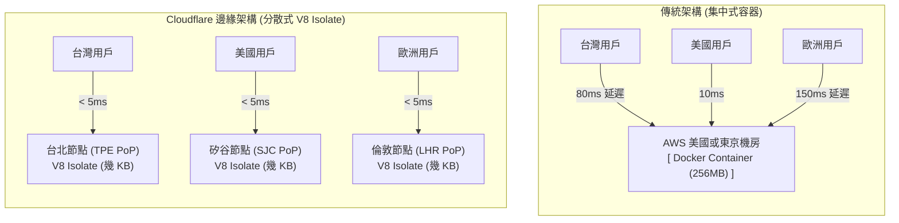
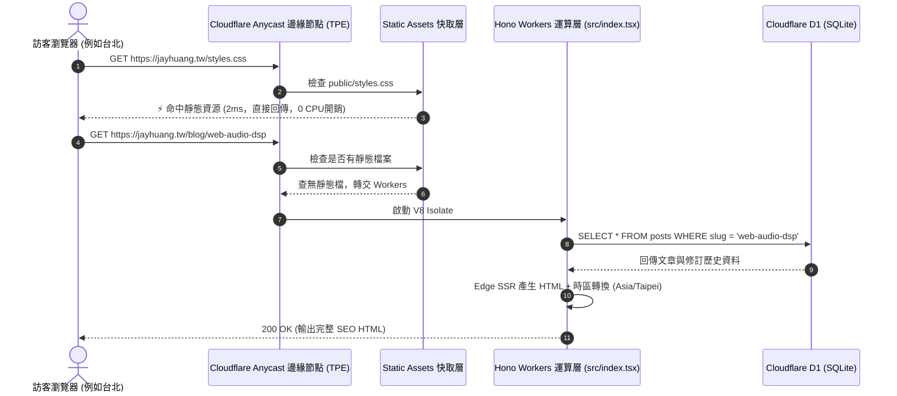
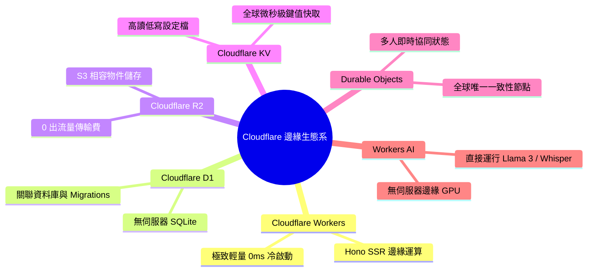

# Cloudflare 邊緣原生架構深度指南 (Cloudflare Edge Architecture Guide)

> 本文件專為從傳統前端/後端跨入「邊緣運算（Edge Computing）」的開發者所撰寫，全面解析 Cloudflare 平台的底層運作原理、本專案所使用的架構設計，以及未來擴展的進階武器庫。

---

## 📑 目錄

1. [核心心智模型：為什麼不是 Node.js 或 Docker？](#1-核心心智模型為什麼不是-nodejs-或-docker)
2. [全球 Anycast 網路與無感冷啟動 (Zero Cold Start)](#2-全球-anycast-網路與無感冷啟動-zero-cold-start)
3. [本專案架構拆解：運算、持久化與靜態分流](#3-本專案架構拆解運算持久化與靜態分流)
   - 3.1 Cloudflare Workers + Hono (邊緣運算層)
   - 3.2 Cloudflare D1 (邊緣關聯資料庫)
   - 3.3 Workers Static Assets (極速靜態分流)
4. [本專案請求生命週期全景圖 (Request Lifecycle)](#4-本專案請求生命週期全景圖-request-lifecycle)
5. [Cloudflare 進階武器庫 (未來擴展指南)](#5-cloudflare-進階武器庫-未來擴展指南)
   - 5.1 Cloudflare R2 (零流量費物件儲存)
   - 5.2 Cloudflare KV (全球微秒級快取)
   - 5.3 Durable Objects (多人即時協同的終極解答)
   - 5.4 Workers AI (邊緣 GPU 無伺服器推論)
6. [常見疑難排解與 Wrangler CLI 實戰指南](#6-常見疑難排解與-wrangler-cli-實戰指南)

---

## 1. 核心心智模型：為什麼不是 Node.js 或 Docker？

傳統雲端開發者習慣將應用程式打包成 **Docker 容器**，部署在單一地理機房（例如 AWS 東京 `ap-northeast-1` 或 GCP 彰化 `asia-east1`）的虛擬機上。

### 傳統伺服器架構 vs Cloudflare 邊緣架構

| 比較維度 | 傳統伺服器 / 容器 (AWS EC2 / ECS / Node.js) | Cloudflare Workers (邊緣 V8 Isolate) |
| :--- | :--- | :--- |
| **地理位置** | 部署於「單一或少數幾個」集中式大型機房 | 自動分散在全球 **300 多個城市** 的邊緣節點 (PoP) |
| **隔離技術** | 虛擬化作業系統 (VM) 或 Linux 命名空間 (Docker 容器) | Google V8 引擎原生安全隔離區塊 (**V8 Isolates**) |
| **記憶體開銷** | 每個實例需要數百 MB 至數 GB (含 Linux kernel、Node runtime) | 每個 Isolate 僅需幾 KB 至幾 MB |
| **冷啟動延遲** | 幾百毫秒至數秒 (需載入 OS、Node.js 模組樹) | **< 5 毫秒 (趨近於 0ms)** |
| **擴展性** | 依賴 Auto Scaling Group 偵測流量，啟動需要 1~3 分鐘 | 全球隨傳隨到，每秒數百萬請求瞬間自動承接 |
| **伺服器維護** | 需要配置 VPC、Subnet、負載平衡器、OS 安全修補 | **完全無伺服器 (Serverless)**，零維護開銷 |



### 什麼是 V8 Isolate？
Google Chrome 瀏覽器在同一個視窗中開啟多個分頁時，各分頁彼此獨立、崩潰時互不影響，這就是靠 Chrome 內部的 **V8 Isolate** 機制。
Cloudflare 將這項技術搬到了伺服器端：**一台實體伺服器可以同時執行數萬個相互隔離的 V8 Isolate**。當您的請求到達離用戶最近的機房時，Workers 僅需幾毫秒即可啟動一個 Isolate 處理請求，完成後立即回收。

---

## 2. 全球 Anycast 網路與無感冷啟動 (Zero Cold Start)

### 什麼是 Anycast 網路？
傳統 DNS（Unicast）將一個 IP 地址對應到特定機房的一台伺服器。
Cloudflare 使用 **Anycast BGP 路由技術**：全球 300 多個數據中心使用「完全相同的一組 IP 地址」。
- 當台灣讀者訪問您的部落格時，網際網路路由會自動將封包導向**台北（TPE）節點**。
- 當美國讀者訪問時，自動導向**洛杉磯（LAX）或舊金山（SFO）節點**。
- 這意味著您的應用在發布的第一秒，就天然具備了全球 CDN 等級的低延遲。

---

## 3. 本專案架構拆解：運算、持久化與靜態分流

在專案的 [`wrangler.jsonc`](file:///d:/project/cv/wrangler.jsonc) 中，定義了三大支柱：

```jsonc
{
  "name": "blog",
  "main": "src/index.tsx",              // 1. 邊緣運算層 (Cloudflare Workers)
  "compatibility_flags": ["nodejs_compat"],
  "assets": {
    "directory": "./public"             // 2. 靜態資源分流層 (Workers Static Assets)
  },
  "d1_databases": [
    {
      "binding": "DB",                  // 3. 邊緣持久化層 (Cloudflare D1 SQLite)
      "database_name": "portfolio-db"
    }
  ]
}
```

### 3.1 Cloudflare Workers + Hono (邊緣運算層)
- **Hono 的角色**：Hono 是專為 Edge 打造的極致輕量 Web 框架（< 15KB），語法與 Express 類似，但內部完全使用 Web Standard API（`Request`、`Response`、`fetch`、`URL`）。
- **Edge SSR (Server-Side Rendering)**：
  - 本專案首頁 `/` 與文章頁面 `/blog/:slug` 是在邊緣節點上直接透過 Hono JSX 即時運算編譯成乾淨的純 HTML 字串。
  - 好處：搜尋引擎爬蟲（Googlebot）第一時間取得完整的 `<title>`、Meta Description 與 JSON-LD 結構化標籤，無需等待任何客戶端 JavaScript 執行，達到滿分 SEO。

### 3.2 Cloudflare D1 (邊緣關聯資料庫)
- **核心技術**：底層是經過深度優化的原生 **SQLite 引擎**。
- **讀取複製 (Read Replication)**：
  - SQLite 是單一檔案資料庫，讀取速度極快（微秒級）。Cloudflare 會自動將資料庫唯讀複本快取在全球靠近使用者的節點，讀取速度堪比記憶體。
- **寫入事務 (Primary Leader Writes)**：
  - 當我們在後台發表新文章或修改密碼時，D1 會自動將寫入請求路由至主資料庫所在的樞紐節點（Primary Region），完成寫入後再異步同步至全球複本。
  - 嚴格保證 ACID 事務特性，杜絕臟讀與寫入衝突。

### 3.3 Workers Static Assets (極速靜態分流)
- **自動分流機制**：
  當請求進入時，Cloudflare 會優先檢查 `public/` 目錄：
  - 如果請求是 `/styles.css`、`/favicon.ico` 或 `/images/projects/*.png`，Cloudflare **直接由全球 CDN 快取返回**，完全**不消耗 Workers CPU 運算時間**（不計費、0 毫秒伺服器開銷）。
  - 如果靜態資源不存在（例如 `/`、`/blog/my-post`、`/admin`），請求才會穿透給 `src/index.tsx` 的 Workers 路由處理。

---

## 4. 本專案請求生命週期全景圖 (Request Lifecycle)



---

## 5. Cloudflare 進階武器庫 (未來擴展指南)

如果您未來想在作品集中加入更多黑科技，以下是 Cloudflare 最受歡迎的 4 大旗艦服務：



### 5.1 Cloudflare R2 (零流量費物件儲存)
- **對標產品**：AWS S3、Google Cloud Storage。
- **殺手級特點**：**0 出流量傳輸費（Zero Egress Fees）**！
  - AWS S3 最貴的地方在於用戶下載圖片時的流量費用。
  - R2 支援完整的 S3 API，您可以用標準的 AWS SDK 上傳圖片、影片、作品集附件，每個月即便被下載幾百萬次，出流量通通免費。

### 5.2 Cloudflare KV (全球微秒級快取)
- **對標產品**：Redis、DynamoDB。
- **特性**：高讀取、低寫入（讀寫比 99:1）。
- **最佳應用**：全域網站設定、短網址跳轉、API Token 快速校驗、計數器快取。

### 5.3 Durable Objects (多人即時協同的終極解答)
- **痛點**：一般的 Serverless 無法做即時聊天室或多人連線遊戲，因為每個請求是獨立無狀態的。
- **Durable Objects 解法**：
  - 它能為特定 ID（例如遊戲房間 `room-101`）在全球某個特定的邊緣伺服器上維持**唯一一個具有持久記憶體狀態的 JavaScript 物件**。
  - 所有進入 `room-101` 的 WebSocket 連線都會直通這個物件，實現微秒級狀態同步。
  - **應用場景**：非常適合您的「DreamCity 多人非對稱桌遊」或「多人線上協同白板」架構！

### 5.4 Workers AI (邊緣 GPU 無伺服器推論)
- **特點**：無需自行架設 GPU 伺服器，直接透過一行程式碼呼叫 Cloudflare 託管的開源大模型：
  - LLM 文字生成：`@cf/meta/llama-3-8b-instruct`
  - 語音轉文字：`@cf/openai/whisper`
  - 影像生成：`@cf/stabilityai/stable-diffusion-xl-base-1.0`
- **範例應用**：可以在後台一鍵使用 Workers AI 自動為您撰寫的文章生成繁體中文摘要與 SEO 標籤。

---

## 6. 常見疑難排解與 Wrangler CLI 實戰指南

### 本地開發與遠端操作常用命令

| 工作目標 | 指令 (PowerShell / Windows) | 說明 |
| :--- | :--- | :--- |
| **本地邊緣模擬運行** | `npm.cmd run dev` | 啟動本地 Miniflare 邊緣模擬器 (localhost:8787) |
| **遠端部署發布** | `npm.cmd run deploy` | 將代碼編譯打包並推送到全球 300+ 邊緣節點 |
| **遠端資料庫查詢** | `npx.cmd wrangler d1 execute DB --remote --command "SELECT * FROM posts LIMIT 5;"` | 直接查詢生產環境 D1 真實資料 |
| **遠端查看資料表結構** | `npx.cmd wrangler d1 execute DB --remote --command "PRAGMA table_info(posts);"` | 檢查正式環境 SQLite 欄位結構 |
| **執行遠端 Migrations** | `npx.cmd wrangler d1 migrations apply DB --remote` | 依序在正式環境執行新的 SQL 遷移腳本 |
| **即時即時日誌流 (Log Stream)** | `npx.cmd wrangler tail` | 監聽線上正在發生的所有真實請求與 console.log |

---

> 💡 **結語**：
> 透過將本專案遷移至 Cloudflare Workers + D1，您已經成功掌握了現代雲原生架構中最前沿的「**邊緣運算（Edge Computing）**」範式。這項技術徹底擺脫了傳統單體伺服器與龐大容器的包袱，在效能、成本與安全性上均達到了世界一流的架構水準。
